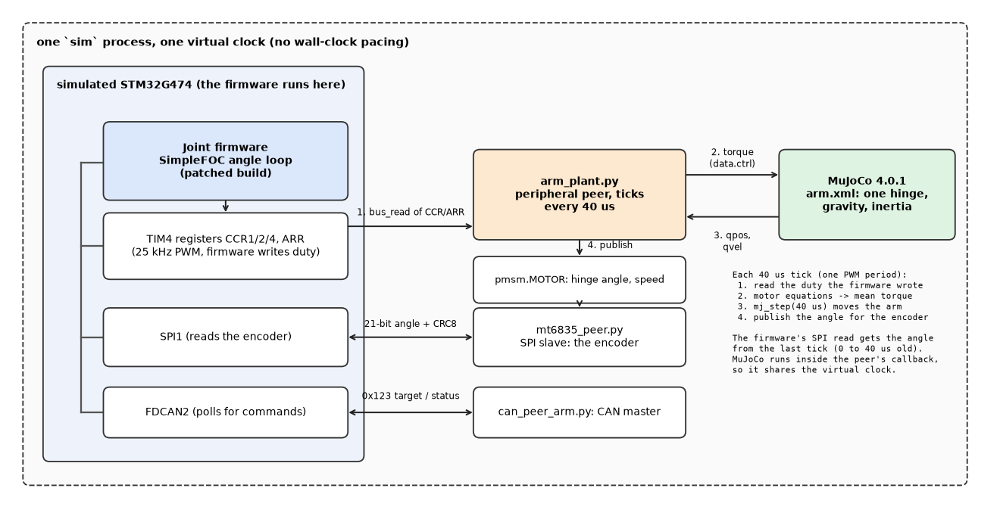
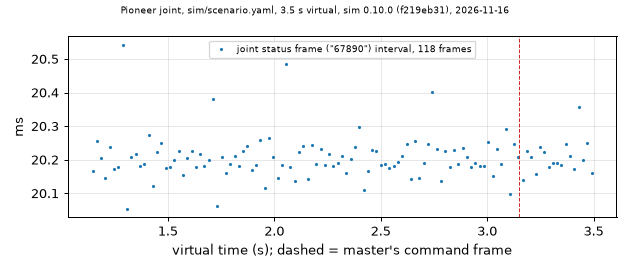
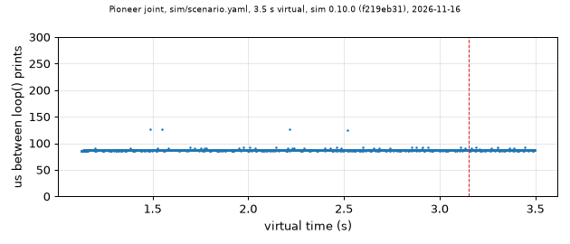
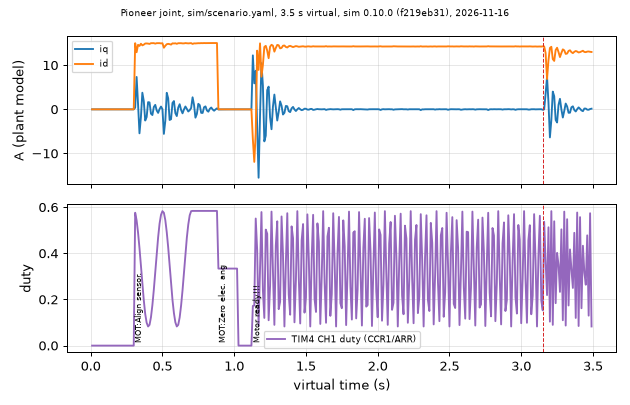
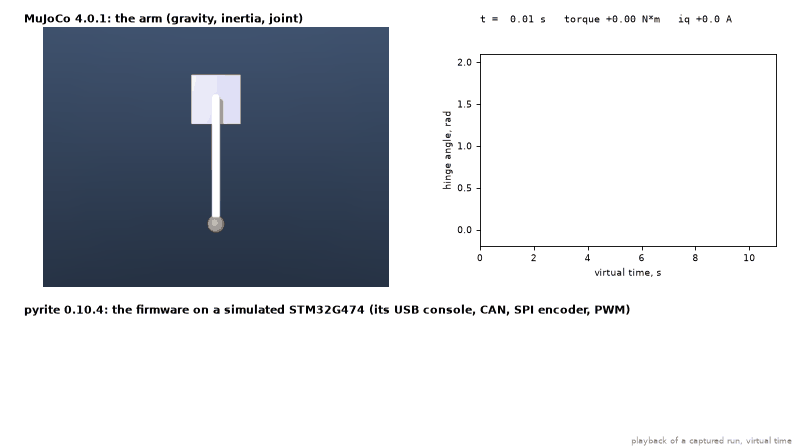
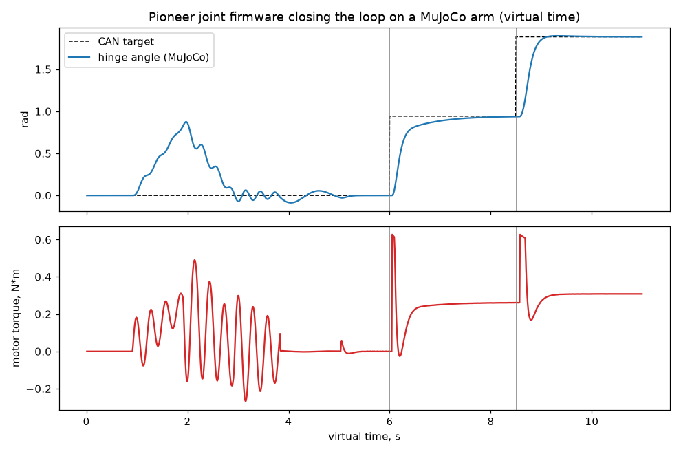
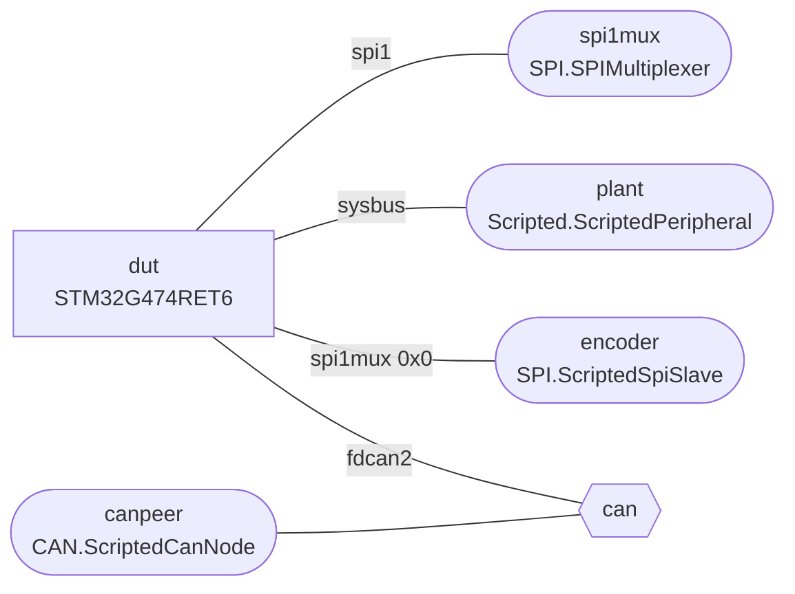

## How it works: the firmware, a simulated STM32 and MuJoCo in lockstep

Everything below runs in one `sim` process on one virtual clock. Nothing is paced by the wall clock, and the same run gives
byte-identical logs under different machine load. MuJoCo is a library the plant peer calls, not a second program, so it
cannot get ahead of or behind the firmware.



Drawn by `sim/mujoco/diagram.py`.
The parts are the scenario `sim graph --scenario sim/scenario-arm.yaml` prints (the STM32, the plant at `0xA0000400`, the encoder on SPI1,
the CAN master on FDCAN2); the arrows are the data flow of `sim/peers/arm_plant.py`.

**One 40 us tick (`sim/peers/arm_plant.py`), in virtual time:**
1. Read the PWM duty the firmware has written: `CCR1/2/4` divided by `ARR`, straight from the simulated TIM4 registers.
2. Turn the duty into phase voltages and integrate the motor's dq currents in ten 4 us sub-steps, using the shaft speed MuJoCo reported at the start of the tick. The mean shaft torque is `1.5 * p * psi * iq`.
3. Set `data.ctrl[0]` to that torque and call `mj_step`, which advances MuJoCo's arm by the same 40 us.
4. Publish MuJoCo's hinge angle and speed in `pmsm.MOTOR`.

Between ticks the firmware runs on its own timing. When it reads the encoder over SPI, `mt6835_peer.py` answers with the angle published at the
last tick, so the firmware sees a value 0 to 40 us old. When the CAN master sends a target (6.0 s and 8.5 s), the firmware's loop
picks it up on its next 100 ms poll.

| Part | Whose it is |
| --- | --- |
| Firmware (SimpleFOC loop, MT6835 driver, CAN handler) | the team's code; the ARM build only changes the control mode, the gains, what the CAN digits mean and the HSE value (`sim/arm-position.patch`) |
| STM32G474 timers, SPI, FDCAN, clock | modelled by the simulator |
| Arm: gravity, inertia, joint damping, rotor armature | MuJoCo, from `sim/mujoco/arm.xml` |
| Motor R, L, flux linkage, pole pairs; averaged switching | ours, stand-ins (the repository does not name the motor) |
| Encoder | ours: reports MuJoCo's angle exactly, 21-bit, status always 0 |
| Joint damping 0.01 N*m*s/rad; the 0.1 kg tip mass | our choices, sized so the stand-in motor can hold the arm |

**What this run does not test.** The mechanism is one revolute joint carrying one link and a point-like mass: there is no kinematic chain,
no inverse kinematics, no coupling between joints, no contact and no changing payload. The gravity torque on the hinge is simply
`m g d sin(q)`, which the log reproduces (0.31 N*m at 1.885 rad against 0.306 N*m). The encoder has no noise and no
mechanical lag, the motor has no friction, cogging or backlash, and there is no gearbox. The controller gains were chosen from ten
settings tried on this same plant. Treat the result as evidence that the firmware's control code, the timer, SPI and CAN
models and MuJoCo exchange data correctly in lockstep, and not as a statement about a real arm.

## This fork: the Pioneer joint board in a simulator

This is Simantic's fork of WATonomous' Pioneer humanoid repository, kept as a simulation showcase. It runs
the joint-board firmware in `src/embedded/STM32` (STM32G474RE, SimpleFOC, MT6835 encoder over SPI, CAN)
on a simulated STM32G474RET6, with no board attached. The fork adds a `sim/` directory and this section;
the committed firmware sources are unchanged (the build-time changes are listed below). Nothing here is
offered back or posted upstream. If you are on the team and want this removed, say so and it goes.

```
joint firmware's own USB console, 3.5 s of virtual time (sim/run.sh)
  [0.301367s] MOT:Align sensor.
  [0.742186s] MOT:sensor dir: CW
  [0.742206s] MOT:PP check: OK!
  [0.886186s] MOT:Zero elec. angle: 6.27
  [0.926203s] ERR-MOT:No current sense.
  [1.126208s] Motor ready!!!
  [3.499977s] 64.49            <- encoder.getAngle(), rad
CAN master                      shaft 25.0 rad/s before command, 101 status frames
                                sent target '32' on 0x123
                                shaft 39.7 rad/s after command, ratio 1.59, 115 status frames
```


Top: the angle the firmware prints from its MT6835 reads (26,279 prints, 64.49 rad at the end). Bottom:
the PMSM stand-in's shaft speed. It settles at 25.0 rad/s, then steps to about 40 rad/s after the master's
command frame at 3.150 s (dashed). Configuration `sim/scenario.yaml`, 3.5 s virtual, Simantic `sim` 0.10.0
(build f219eb31), 2026-11-16; angle from the run's USB console log, speed from the plant peer's own log.



The joint's 0x123 status frames from the run's `--frames` capture: 118 frames, first at 1.126 s, mean
interval 20.21 ms (range 20.05 to 20.54 ms). The firmware sends one every 100 ms of its own `millis()`, see
"Clock" below for why that is 20 ms of virtual time. Same configuration and sim build.



Virtual time between consecutive encoder prints, i.e. one pass of `loop()` (SPI read, `loopFOC`, print):
median 87 us, maximum 385 us, with no change at the CAN command. Same configuration and sim build.



The plant's dq currents and the TIM4 CH1 duty the firmware writes, over the alignment (0.30 s to 0.93 s) and
the open-loop run. These currents are the stand-in's state, not a firmware measurement: the firmware
reports `ERR-MOT:No current sense.` and has none. Same configuration and sim build.

### The joint firmware on a MuJoCo arm (lockstep with an outside physics simulator)

The same joint firmware drives a hinge in [MuJoCo](https://mujoco.org), stepped in lockstep with the simulated MCU. Every 40 us of
virtual time `sim/peers/arm_plant.py` reads the PWM duty the firmware has written to TIM4, integrates the motor's dq currents, gives
MuJoCo the shaft torque, steps MuJoCo (`sim/mujoco/arm.xml`: a 0.3 m link, 0.12 kg total, gravity on, rotor armature 2e-4) by the same 40 us and
returns the hinge angle through the MT6835 encoder peer. The firmware closes its own SimpleFOC angle loop on that encoder. A CAN
master sends two target angles. The mechanics are MuJoCo's, not code of ours.



Rendered through MuJoCo's own renderer from the captured run (`sim/mujoco/render_run.py`; MP4: `sim/screenshots/arm-mujoco.mp4`).
Left, the arm and a green ghost at the angle the CAN master commanded; right, the hinge angle over virtual time; below, what the
simulated STM32 printed and received. It plays at the run's own virtual time, one frame per 40 ms. A plain 2D playback of the same
samples is `sim/screenshots/arm-playback.gif`.

The GIF is a playback of the captured run's 10 ms samples (virtual time). The plot is the same run:



Measured with `sim` 0.10.4 (build cd27ee45), MuJoCo 4.0.1, 2026-11-18, `sim/run-arm.sh` (11 s virtual): after the firmware's
sensor alignment (0.9 s to 5.0 s, `Motor ready!!!` at 5.036 s) the CAN master steps the target to 0.942 rad at 6.0 s and 1.885 rad at 8.5 s.
Peak 0.938 rad (-0.5%) and 1.896 rad (+0.6%); mean error over the last 0.5 s of each hold -0.0074 and +0.0011 rad. The holding torque
at 1.885 rad is 0.31 N*m, MuJoCo's own m g d sin(q) for this arm is 0.306 N*m. Two runs gave byte-identical logs.

**How to run it:** `ARM=1 sh sim/build.sh`, then `VENV=<venv with mujoco numpy matplotlib> sh sim/run-arm.sh`. The default build is unchanged.

**What it changes and what is still ours:**
- `sim/arm-position.patch` (applied by `ARM=1` only) switches the firmware from `velocity_openloop` to `MotionControlType::angle`
  (P_angle 6, velocity PI 1.0 and 2), reads the two CAN digits as an angle of NN/100 pi rad and starts the target at 0. The ARM build also
  sets `HSE_VALUE=24000000U`, the NUCLEO crystal this scenario declares, so `millis()` is right (the default scenario's 5x-fast clock is
  described under "Clock" below). Ten gain settings were tried; the earlier ones rang, this is the one reported.
- The motor's R, L, flux linkage and pole pairs are stand-ins (the repository does not name the motor), and the joint damping
  (0.01 N*m*s/rad) is an assumed value: `MODELED SIMPLIFICATION`. The arm is also sized to the stand-in motor: a first
  version with a 0.5 kg tip mass needed 1.5 N*m to hold against gravity, more than the stand-in's 0.63 N*m, so the tip mass is 0.1 kg. Switching is averaged and torque and speed are exchanged once per 40 us.
- During alignment the firmware reports `PP check: fail - est. pp: 7.88` (the arm is gravity-loaded and swings; the motor has 7).
  SimpleFOC continues. This was not investigated further.

**What runs:**

| Part | In the simulation |
| --- | --- |
| Joint firmware (`nucleo_g474re` env, `src/main.cpp`) | Arduino core, SimpleFOC `BLDCDriver3PWM` on TIM4, MT6835 on SPI1, FDCAN2, console on USB CDC |
| PMSM plant (`sim/peers/foc_plant.py`) | reads TIM4 duty, integrates dq currents and rotor speed; stand-in, not the real motor |
| MT6835 encoder (`sim/peers/mt6835_peer.py`) | answers the driver's `0xA0 0x03` angle burst read (21-bit angle, status, CRC8) from the plant's shaft |
| CAN master (`sim/peers/can_peer.py`) | receives the joint's frames on std ID 0x123 and sends the `"32"` speed command |
| Bootloader + FreeRTOS app (`bootloader` and `app` envs) | second image, boots on its own, see the table below |

**The scenario**, as `sim graph --scenario sim/scenario.yaml` prints it:



**Configurations tried** (all with `sim` 0.10.0, build f219eb31, 2026-11-16; wall times on a loaded laptop):

| Configuration | Where | Virtual | Wall | Result |
| --- | --- | --- | --- | --- |
| Joint, HSE 24 MHz (the NUCLEO crystal) | `sim/scenario.yaml`, `sim/run.sh` | 3.5 s | 22 to 26 s | runs: alignment passes (`sensor dir: CW`, `PP check: OK!`), `Motor ready!!!` at 1.126 s, 118 status frames, shaft follows the CAN command (ratio 1.59) |
| Joint, HSE 4.8 MHz (the `HSE_VALUE` in their `platformio.ini`) | `sim/scenario-hse4p8.yaml` | 3.5 s | 2.8 s | does not run: the USB console prints nothing, no CAN status frame is sent, the shaft stays at 0.0 rad/s |
| Bootloader + FreeRTOS app, console patch | `sim/build-boot.sh`, `sim/run-boot.sh` | 5 s | 0.9 s | runs: `PIONEER: app up` at 1.37 ms, ticks 1.006 s apart, `RESULT: PASS` at 4.013 s |

The joint image is `firmware.elf` from `pio run -e nucleo_g474re` (sha256 prefix 1097640619bb639a; a second
build gave the same hash).

**Clock** (from `app/src/system.c`, source reading plus the boot image run; the boot image was not rebuilt).
`SystemClock_Config` uses STM32F4 PLL values on a G4: HSI source, `PLLM = 16`, `PLLN = 336`, `PLLP = DIV4`,
`PLLQ = 7`, and `RCC_OscInitTypeDef` is not zero-initialised, so `PLLR` is whatever was on the stack. On the
STM32G4, PLLN is a 7-bit field (RM0440 section 7.4.4, bits 14:8, legal 8 to 127; HAL's `IS_RCC_PLLN_VALUE` is
also 8 to 127), so `336 << 8` leaves PLLN = 0x50 = 80 and spills into bit 16 (PLLPEN). With `PLLM = 16` on HSI16
the VCO input is 1 MHz (datasheet range 2.66 to 16 MHz) and the VCO is 80 MHz (datasheet minimum 96 MHz): out
of spec. The simulator masks PLLN to 7 bits, warns, and still sets PLLRDY, because a silicon measurement
(NUCLEO-G474RE rev X) locked at 1 MHz / 80 MHz. The app prints `SYSCLK: 13333333`; a PLLR field of 6 would give
80 / 6 = 13.33 MHz, but that PLLR is 6 in this image is `unverified`. HAL, SysTick and `HAL_Delay` agree with
13.33 MHz (ticks land 1.002 s apart). This is a firmware configuration issue rather than a simulator model
issue. A legal example is HSI16 / 4 x 85 / 2 = 170 MHz.

**Corrected (2026-11-16).** An earlier version of this section said the G4 field width was not checked and
framed 13.33 MHz against a 16 MHz expectation as a model question. The field width is now checked against
RM0440, and the 13.33 MHz figure follows from the source configuration.
For the joint image the `HSE_VALUE=4800000U` build flag differs from the NUCLEO's 24 MHz crystal, so
the first scenario declares 24 MHz. `millis()` then runs about 5x fast, consistent with that mismatch: the
0x123 frames come every 20.2 ms of virtual time instead of every 100 ms. The CAN check is therefore a speed ratio (1.45 to 1.75 accepted by
the peer).

**Gaps, with the evidence:**
- **The joint does not run at 4.8 MHz HSE in the simulator** (`sim/scenario-hse4p8.yaml`). The log shows
  the RCC computing a 57.6 MHz VCO; the console, which waits on USB (`while (!Serial)` in `main.cpp`), is
  silent. That USB is the blocker is read from the source, not isolated in a run: `unverified`.
- **`ERR-MOT:No current sense.`** is printed by SimpleFOC at start-up: this firmware has no current sensing.
- **The motor runs open loop** (`motor.controller = velocity_openloop`, `main.cpp:137`): the encoder is read
  and printed but does not close a loop.
- **The CAN protocol is not the DBC and not the CubeMars protocol.** `main.cpp` sends the ASCII bytes
  `67890` on std ID 0x123 and reads two ASCII digits from 0x123 as `25 * NN / 100` rad/s; a search of
  `src/embedded/STM32/src` and `include` finds no mention of CubeMars or the DBC. No CubeMars motor is
  simulated.
- The plant, the encoder's status bits (always 0) and the 0.6 electrical radian start offset are stand-ins
  chosen for the run; the peers mark them `MODELED SIMPLIFICATION`.
- Not run: the ESP32-S3 sources, the Python and ROS modules, silicon.

**Run it** (needs PlatformIO with the ststm32 platform, and Simantic's `sim` on PATH):

```
sim/build.sh        # builds sim/build/joint.elf
sim/run.sh          # 3.5 virtual seconds; logs and frame capture in sim/out/, exits 1 unless the checks hold
sim/build-boot.sh   # builds sim/build/boot.elf (bootloader + app)
sim/run-boot.sh
python3 sim/plot.py "caption"   # redraws sim/screenshots/*.png from sim/out/ (needs matplotlib)
```

**Changes to the firmware: none are committed.** The scripts make these build-time changes and restore the
files afterwards:
- `platformio.ini`: `lib_ignore = FreeRTOS-Kernel` for the `nucleo_g474re` env (the library finder pulls the
  vendored kernel into the Arduino build, which has no `FreeRTOSConfig`); for the `app` env, `foc.cpp` is dropped
  from `build_src_filter` (it includes Arduino headers inside the stm32cube env).
- In the downloaded libraries (`.pio/libdeps`): `enableTimerClock(handle)` becomes `enableTimerClock(handle->Instance)`
  in Simple FOC 2.4.0 and likewise in SimpleFOCDrivers 1.0.9 `STM32HWEncoder.cpp`.
- A build flag `-include stm32g4xx_hal.h`, because `src/Drivers/*.h` include HAL headers without the umbrella header.
- `sim/firmware-console.patch` (boot image only): adds a console on LPUART1 (PA2/PA3) to `app/src/firmware.c`,
  since the stm32cube envs print nothing.
- `pad_bootloader.py` is run by hand and its output copied to `../.pio/build/bootloader/`, where `app/src/bootloader.S` `.incbin`s it.

**Licence.** The repository is Apache-2.0 and `LICENSE` is kept. The files under `sim/` are additions by
Simantic, not by the Pioneer team; the peers, scenarios and scripts there are offered under the same licence.

Everything below is the Pioneer team's README.

---

# Pioneer - UWaterloo's First Humanoid Robot 

We are a team of undergraduate student from UWaterloo building a 160 cm humanoid robot. We are the first engineering design team in Canada building a humanoid!

Our humanoid robot will feature 2 arms + 2 legs and we are also developing a 22 DOF humanoid hand that can be modularly switchable with the arm gripper.

More info at Pioneer's website: https://watonomous.github.io/humanoid-docs/index.html

## Find your subteam

| Subteam | Start here |
|---|---|
| Software: manipulation | [`src/teleop`](src/teleop) · [`src/robot_learning`](src/robot_learning) · [`src/simulation`](src/simulation) |
| Software: locomotion | [`src/simulation/humanoid_rl`](src/simulation/humanoid_rl) · [`src/simulation/humanoid_rl_tasks`](src/simulation/humanoid_rl_tasks) |
| Firmware / interfacing | [`src/embedded`](src/embedded) · [`src/interfacing`](src/interfacing) |
| Perception | [`src/perception`](src/perception) |

## Quick start

`watod` is our Docker Compose wrapper: it spins up one dev container per module (interfacing, perception, simulation, …), so you only run the stack your subteam needs.

```bash
cp watod-config.sh watod-config.local.sh   # set your ACTIVE_MODULES
./watod up -d                 # start your modules
./watod -t <service>          # shell into one (interfacing, perception, simulation_mj, ...)
./watod build <service>       # rebuild after a Dockerfile / dependency change
./watod down                  # stop
```

Your `src/<module>` folder is mounted into the container, so edits on your machine show up inside it immediately without rebuild.

`watod-config.sh` is shared defaults and is CI-guarded, so don't commit personal changes to it. Everything local goes in `watod-config.local.sh` (gitignored).

| `ACTIVE_MODULES` | What it runs |
|------------------|--------------|
| `interfacing` | CAN / hardware interfacing, `joint_command` |
| `perception` | Perception (cameras, GPU), `voxel_grid` |
| `simulation_isaac` | **Isaac Lab 2.3.2** — SO101 robot learning, RL tasks, Quest teleop |
| `simulation_mj` | MuJoCo / mjlab RL |
| `terrain_mapping` | GPU elevation map from D455 bags ([src/terrain_mapping](src/terrain_mapping)) |

**Isaac Lab sim (recommended):** see [docker/simulation/isaac_lab/README.md](docker/simulation/isaac_lab/README.md).

## Repo map

Two workflows share this repo:

- **Real robot:** `embedded` firmware ⇄ `interfacing` (CAN ⇄ ROS 2) ⇄ `perception` — driven live by `teleop`, or by a policy.
- **Sim / learning:** `teleop` collects demos in `simulation` scenes → `robot_learning` records datasets and trains policies, or `simulation/humanoid_rl` trains RL policies → deploy back through `interfacing`.

**`robot_learning` vs RL:** `src/robot_learning` learns policies from recorded datasets (sim or real), e.g. ACT, SmolVLA, pi0.5. RL is sim-based (Isaac Lab), so it lives in `src/simulation/humanoid_rl*`.

```
humanoid
├── watod, watod-config.sh   # container orchestrator + module config
├── modules/  docker/        # compose files + Dockerfiles, per module
├── src/
│   ├── pioneer_humanoid/    # the robot definition (imported everywhere)
│   ├── interfacing/         # CAN ⇄ ROS 2 bridge, real-arm bring-up
│   ├── embedded/            # STM32 / ESP32S3 motor firmware
│   ├── perception/          # cameras, voxel grid
│   ├── terrain_mapping/     # GPU elevation mapping (elevation_mapping_cupy)
│   ├── simulation/          # Isaac Lab + MuJoCo: RL tasks, teleop scenes
│   ├── teleop/              # drive the arm (sim or real)
│   ├── robot_learning/      # record demos, train / eval policies
│   └── common_msgs/         # shared ROS 2 messages
├── assets/                  # robot URDF / USD / meshes, scene props
├── models/                  # frozen RL policy baselines
├── outputs/                 # training runs (gitignored)
└── docs/                    # pointer to the docs site
```

Full detail — [src/simulation/README.md](src/simulation/README.md). Other areas: each has its own `README.md`.

## CAN / arm bring-up

Connect → calibrate → visualize → move, top to bottom: [src/interfacing/README.md](src/interfacing/README.md)

```bash
./src/interfacing/can/scripts/can_udev.sh install   # once per host → /dev/canable
```

## Things to know

- CI does **not** build `simulation_*` or `embedded`. A green check on those means nothing was built, so test them yourself.
- Set a unique `ROS_DOMAIN_ID` (0–232) in `watod-config.local.sh` if someone else runs ROS on the same subnet, or you will see each other's topics.
